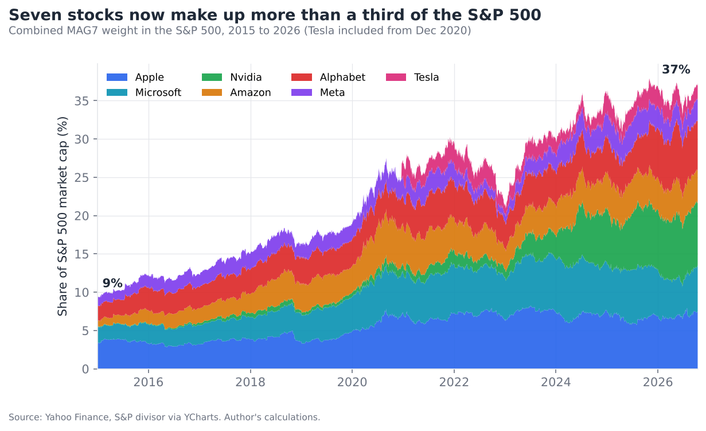

# Seven Stocks, One Index

How MAG7 concentration shaped S&P 500 returns and risk, 2015 to 2026.

Independent research by Gabriel Pedras, University of St Andrews.

## Key findings (2 Jan 2015 to 13 Oct 2026)

- The MAG7 (Apple, Microsoft, Nvidia, Amazon, Alphabet, Meta, Tesla) grew from 9% to 37% of the S&P 500.
- A cap-weighted MAG7 basket returned 25.8% a year. The other stocks in the index returned 8.5% a year.
- From 2023 to 2025 the MAG7 delivered about 61% of the index's price return.
- SPY (cap-weighted) returned about 360% including dividends. RSP (equal-weighted) returned about 225%.
- At today's weight, a 30% MAG7 fall cuts the index by about 11% even if every other stock is flat.



## Method

- Market cap = split-adjusted shares outstanding x closing price.
- Total S&P 500 market cap = index level x S&P 500 divisor (quarter-end values from YCharts, interpolated).
- Index weight = stock market cap / total index market cap.
- Annual contribution = start-of-year weight x price return over the year.
- Tesla has zero weight before it joined the index on 21 December 2020. Alphabet is counted once.

Limitations: full rather than float-adjusted market caps, so MAG7 weight is probably overstated by 1 to 2 points. Meta share counts before June 2022 are approximated. See the report for detail.

## How to reproduce

Requires Python 3.10 or later.

```
pip install -r requirements.txt
python download_data.py
python download_fix.py
python analysis.py
```

The first two scripts download data from Yahoo Finance into `data/`. The third writes charts and tables into `output/`. Yahoo Finance data is revised over time, so a fresh download may give slightly different figures.

## Files

| File | Purpose |
| --- | --- |
| `download_data.py` | Downloads prices and shares outstanding |
| `download_fix.py` | Downloads SPY prices and stock split history |
| `analysis.py` | Calculates weights, attribution, comparisons and stress test, and draws the charts |
| `output/` | Charts (PNG) and result tables (CSV) |

## Disclaimer

Student research for educational purposes. Not investment advice. Past performance is not a guide to future returns.
